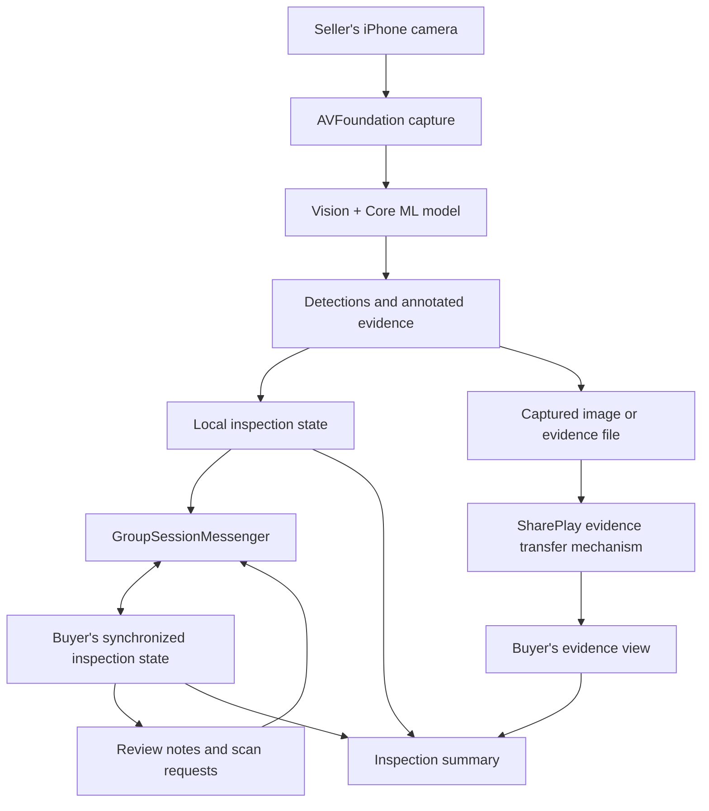

erd


Enum RoomStatus {
  scheduled
  active
  completed
}

Enum RequestStatus {
  pending
  accepted
  rejected
}

Table users {
  id integer [pk, increment]
  name varchar(100)
  email varchar(255) [unique]
  password_hash varchar(255)
  role varchar(20)
  created_at timestamp
}

Table coffee_lots {
  id integer [pk, increment]
  seller_id integer [ref: > users.id]
  lot_code varchar(100) [unique]
  name varchar(255)
  variety varchar(100)
  origin varchar(255)
  quantity_kg decimal(12,2)
  created_at timestamp
}

Table inspection_rooms {
  id integer [pk, increment]
  coffee_lot_id integer [ref: > coffee_lots.id]
  room_code varchar(50) [unique]
  status RoomStatus
  scheduled_at timestamp
  created_at timestamp
}

Table room_members {
  id integer [pk, increment]
  room_id integer [ref: > inspection_rooms.id]
  user_id integer [ref: > users.id]
  role varchar(20)
  joined_at timestamp

  indexes {
    (room_id, user_id) [unique]
  }
}

Table inspection_requests {
  id integer [pk, increment]
  room_id integer [ref: > inspection_rooms.id]
  requested_by integer [ref: > users.id]
  request_type varchar(50)
  status RequestStatus
  message text
  created_at timestamp
}

Table inspections {
  id integer [pk, increment]
  room_id integer [ref: > inspection_rooms.id]
  captured_by integer [ref: > users.id]
  sample_number integer
  layer varchar(20)
  image_url varchar(500)
  model_version varchar(50)
  quality_score decimal(5,2)
  healthy_percent decimal(5,2)
  damaged_percent decimal(5,2)
  insect_damage_percent decimal(5,2)
  confidence_percent decimal(5,2)
  created_at timestamp
}

Table detections {
  id integer [pk, increment]
  inspection_id integer [ref: > inspections.id]
  label varchar(100)
  confidence decimal(5,4)
  x decimal(8,6)
  y decimal(8,6)
  width decimal(8,6)
  height decimal(8,6)
}

Table reports {
  id integer [pk, increment]
  room_id integer [ref: > inspection_rooms.id]
  generated_by integer [ref: > users.id]
  final_quality_score decimal(5,2)
  summary text
  pdf_url varchar(500)
  created_at timestamp
}


app concept and feature
basically connecting seller and buyer coffe thorugh live quality inspection and progressive report

# Exportra Live Inspection ☕

**Collaborative, AI-powered green coffee quality inspection on iOS.**

Exportra Live Inspection helps coffee sellers and buyers inspect green coffee samples together, remotely. Sellers scan coffee beans using an iPhone, while buyers review shared inspection evidence, request additional scans, and make more informed purchasing decisions.

> **Project status:** Concept / Proof of Concept (POC). The features and architecture below describe the proposed product, **not an already shipped or validated implementation**.

## The Problem

Green coffee quality assessment often depends on manual visual inspection and trust between parties. When buyers cannot examine a sample in person, a seller-provided quality claim or photograph may not be sufficient. A remote assessment also risks overlooking defective beans, inspecting only one side, or using samples that do not represent the overall lot.

## Our Solution

Exportra turns quality assessment into a **shared inspection workflow**:

- **On-device visual AI:** Analyze green coffee images with Apple's Vision and Core ML frameworks.
- **Collaborative review:** Keep the buyer and seller synchronized with SharePlay.
- **Guided sampling:** Capture multiple samples and sides of the beans, with a record of how samples were taken.
- **Reviewable evidence:** Share annotated captures, detected defects, and inspection notes.
- **Decision support:** Generate an inspection summary to support follow-up testing, negotiation, or rejection.

**Value proposition:** *Inspect coffee quality together, remotely, and make more confident purchasing decisions.*

## Who It's For

| Role | What they do |
| --- | --- |
| **Farmer / Seller** | Selects a coffee lot, prepares representative samples, scans beans, and shares inspection evidence. |
| **Collector / Buyer** | Joins a shared session, reviews images and detection results, requests more captures, and records a decision. |

The wider use case is agricultural supply-chain quality transparency, including buyers and collectors working toward export-grade consistency. This is **not** a replacement for formal grading or export certification.

## Proposed MVP Features

| Feature | Description | Priority |
| --- | --- | --- |
| Coffee lot overview | View lot origin, variety, quantity, and supplied quality details. | P1 |
| SharePlay inspection session | Synchronize inspection state between seller and buyer. | P0 |
| On-device AI scan | Run a green coffee defect detection model on iPhone camera captures. | P0 |
| Annotated snapshots | Present captured images with bounding boxes, classifications, and confidence scores. | P1 |
| Shared evidence | Deliver captured evidence and inspection results to participants. | P1 |
| Remote scan requests | Ask the seller to rescan or show another side or sample. | P1 |
| Collaborative review | Record buyer feedback and flag results for further inspection. | P1 |
| Inspection summary | Combine samples, detection results, evidence, and notes. | P2 |

**Defect taxonomy:** The precise labels must be established from the chosen grading reference and the annotated training dataset. Detection performance for each class must be independently evaluated before use in purchasing decisions.

## User Journey

1. **Select a lot** — The buyer opens a lot's details and requests an inspection.
2. **Join a session** — Seller and buyer connect through FaceTime and an Exportra SharePlay activity.
3. **Prepare samples** — The seller draws samples from different parts of the lot and places beans on a suitable contrasting surface.
4. **Scan** — The seller captures one side, then turns beans over or takes another sample for subsequent images.
5. **Run detection** — Vision and Core ML process images locally, producing proposed defect labels and bounding boxes.
6. **Share evidence** — Both users review the same annotated capture and summarized results.
7. **Collaborate** — The buyer requests a rescan, another view, or an additional sample, and adds notes.
8. **Review a summary** — The app assembles captures, observations, limitations, and buyer feedback.
9. **Decide next steps** — The buyer may continue negotiation, request lab testing, or decline the lot.

## Technical Architecture



### iOS Technology Stack

| Technology | Intended responsibility |
| --- | --- |
| **Swift / SwiftUI** | Native iOS interfaces and application state. |
| **AVFoundation** | Camera capture and frame acquisition. |
| **Vision** | Image processing and model inference integration. |
| **Core ML** | On-device object detection model execution. |
| **YOLO (converted to Core ML)** | Candidate object detection approach; model quality depends on training data. |
| **GroupActivities / SharePlay** | Shared activity lifecycle and synchronized session participation. |
| **GroupSessionMessenger** | Exchange Codable inspection state, results, and control messages. |
| **GroupSessionJournal** | Candidate mechanism for sharing captured images or files; validate in POC. |
| **FaceTime** | Conversation between participants, separate from the application's AI inference. |

### Data Flow

**Seller device:** Camera → frame/capture → Vision + Core ML inference → defect results → annotated capture → shared inspection state/evidence.

**Buyer device:** Receive synchronized results and evidence → review → add feedback or request another capture → synchronize feedback with seller.

A representative message model (illustrative only):

```swift
import Foundation
import CoreGraphics

struct BeanDetection: Codable, Sendable {
    let label: String
    let confidence: Float
    // Normalized [0, 1] coordinates; define orientation and origin consistently.
    let x: Double
    let y: Double
    let width: Double
    let height: Double
}

struct InspectionResult: Codable, Sendable {
    let inspectionID: UUID
    let sampleID: UUID
    let timestamp: Date
    let detectedBeanCount: Int
    let detectedDefectCount: Int
    let detections: [BeanDetection]
}
```

Send **capture-level results or meaningful state changes**, rather than broadcasting every inference frame through SharePlay. This reduces network traffic and avoids unstable results caused by frame-to-frame variation. Persisting results between sessions would require a storage strategy that is **not yet specified**.

## SharePlay: Important Technical Limitations

SharePlay is a **session synchronization framework**, not a transport for a custom live camera feed or direct access to FaceTime video frames.

The recommended MVP is **SharePlay + Snapshot Inspection**: the seller scans locally and shares captured images, results, and requests with the buyer. **Continuous shared video is not guaranteed by SharePlay.**

An alternative, more complex option is **in-app live video using WebRTC** with separate signaling and real-time media handling; SharePlay would then be optional.

**Critical POC risk:** Camera concurrency. Test whether `AVCaptureSession` works as required while FaceTime and SharePlay are active on the target physical iPhones. Also verify what buyers can see and whether image transfer and detection metadata remain correctly aligned. Do not assume simultaneous camera access is supported in every device/OS configuration.

## Quality and Trust Safeguards

An AI scan does **not** establish whether an entire lot is export-ready.

- **Representative sampling:** Document where samples came from and avoid selectively showing only the best beans.
- **Multi-view examination:** Inspect multiple sides because a single image may hide defects.
- **Human review:** Treat model classifications as decision support, not definitive grading.
- **Traceability:** Associate evidence with a specific lot, sample, capture time, and review outcome.
- **Physical and laboratory checks:** Moisture, density, and other required parameters need appropriate measurement methods and cannot be reliably inferred from visual detection alone.
- **Grading validity:** Inspection and export compliance depend on applicable standards, acceptance thresholds, sample sizes, and verification methods; these remain to be defined.

## POC Validation Checklist

- [ ] **P0 — SharePlay connectivity:** Two physical iPhones can join the same GroupActivity and exchange test messages.
- [ ] **P0 — Camera concurrency:** Verify AVFoundation capture while a FaceTime + SharePlay session is active.
- [ ] **P0 — On-device detection:** Run a trained Core ML model and display bounding boxes on actual green coffee captures.
- [ ] **P1 — Shared evidence:** Transfer a captured image and associated results and render them consistently on the buyer's device.
- [ ] **P1 — Remote scan request:** Send and receive a request to rescan or capture another side.
- [ ] **P2 — Inspection report:** Combine captures, findings, and buyer review into a usable summary.

### Suggested Success Criteria

These are **proposed test criteria**, not measured outcomes:

1. Two test devices can complete a full shared inspection session.
2. Each saved capture is linked to the correct sample and detection result on both devices.
3. A buyer can request and receive a subsequent scan without leaving the workflow.
4. FaceTime/camera limitations are documented on the target iOS and iPhone configuration.
5. Model evaluation reports detection performance by defect class and identifies known failure cases.

## Roadmap

| Phase | Goal | Deliverable |
| --- | --- | --- |
| **1. Feasibility** | Validate SharePlay messaging, FaceTime/camera coexistence, and snapshot transfer. | Two-device technical POC. |
| **2. AI Inspection** | Prepare labeled coffee data, train/evaluate a detector, and integrate a Core ML model. | Local scanning prototype. |
| **3. Collaboration** | Connect lot/sample selection, shared images, rescan requests, and buyer notes. | End-to-end MVP journey. |
| **4. Reporting & Validation** | Produce summaries and evaluate workflow with real buyers/sellers. | Tested inspection prototype and documented limitations. |
| **Future exploration** | Consider in-app WebRTC streaming, deeper traceability, and links to market/export workflows. | Subject to research and feasibility. |

## Proposed Project Structure

*Illustrative only; this is not a statement about existing repository files.*

```text
ExportraLiveInspection/
├── App/
├── Features/
│   ├── Lots/
│   ├── Inspection/
│   │   ├── Camera/
│   │   ├── Detection/
│   │   ├── Evidence/
│   │   └── Review/
│   ├── SharePlay/
│   └── Reports/
├── Core/
│   ├── Models/
│   ├── Services/
│   └── Utilities/
├── Resources/
│   └── MLModels/
└── Tests/
```

## Getting Started (Planned)

This repository is currently documented as a **concept/POC**, so there are no verified build or install instructions yet. Once an Xcode project exists:

1. Open the project in a compatible Xcode version.
2. Configure the required signing, capabilities, and camera usage description.
3. Add the trained `.mlmodel` or `.mlpackage` to the app target.
4. Run on physical iPhones and test the SharePlay flow with two participants.
5. Record device/OS versions and any FaceTime camera conflicts.

## References

- [Apple Developer — GroupActivities](https://developer.apple.com/documentation/groupactivities)
- [Apple Developer — GroupSessionMessenger](https://developer.apple.com/documentation/groupactivities/groupsessionmessenger)
- [Apple Developer — Vision](https://developer.apple.com/documentation/vision)
- [Apple Developer — Core ML](https://developer.apple.com/documentation/coreml)
- [Apple Developer — AVFoundation](https://developer.apple.com/documentation/avfoundation)

## Product Vision

> **Help agricultural commodity sellers and buyers build trust in product quality through collaborative, AI-powered inspections using Vision, Core ML, and SharePlay on iOS.**

**Exportra Live Inspection** extends product quality assessment from an individual scanning task into a collaborative, evidence-based purchasing workflow.

---

*Concept documentation. Product scope, model performance, grading rules, supported devices, and technical feasibility are subject to validation.*
